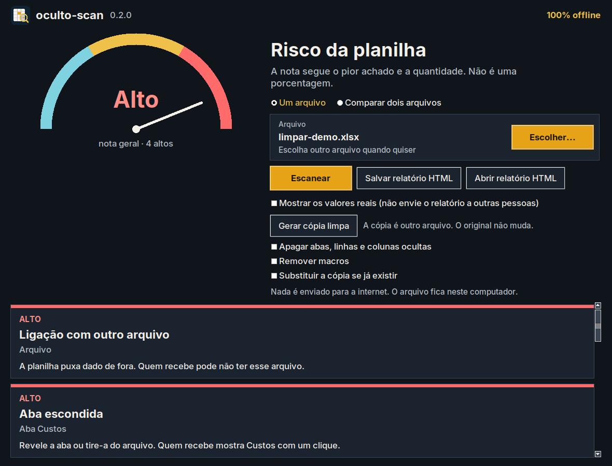
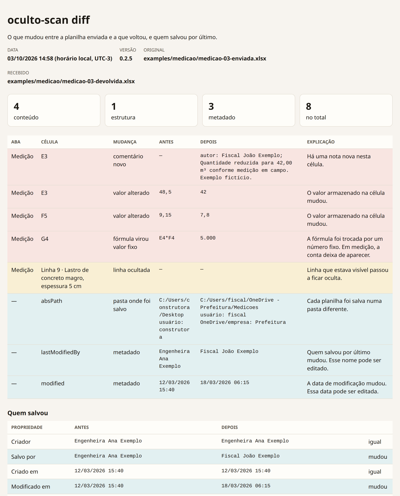
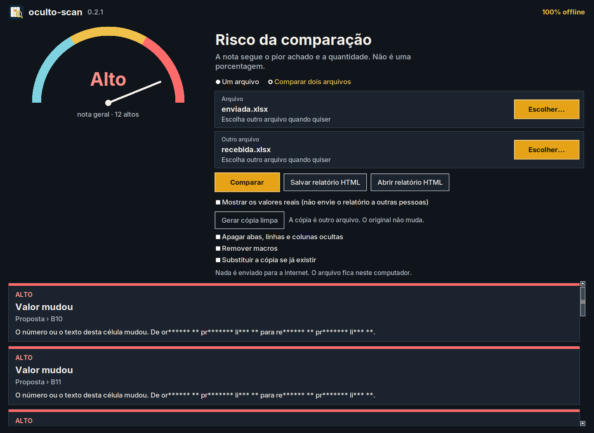
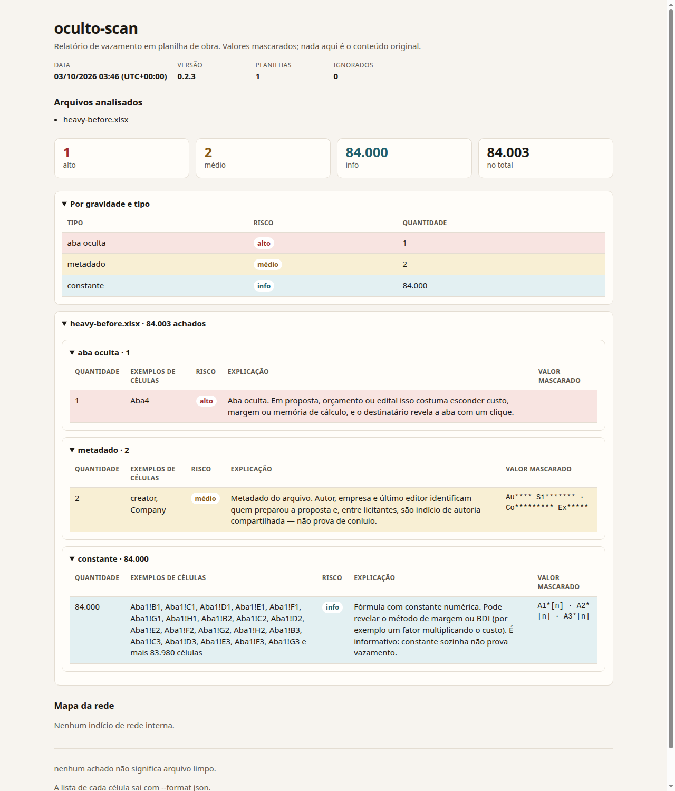

<h1 align="center">oculto-scan Pro</h1>

<strong>Ache o que vaza na planilha antes de enviar a proposta.</strong>

100% offline · Windows · por NeoRise Technology

  

## Isso já aconteceu com você?

- Enviou um boletim de medição e não sabe o que o fiscal ou a empresa alterou?
- Vai mandar uma proposta sigilosa de licitação?
- A planilha tem CPF, CNPJ ou nomes que não deveriam sair?

O oculto-scan Pro lê a planilha (`.xlsx` e `.xlsm`) **antes** do envio e junta, num lugar só, o que costuma passar despercebido. Quando a planilha volta, ele mostra o que mudou e onde.

## O que ele encontra

| | |
| --- | --- |
| 🙈 | Abas, linhas e colunas ocultas |
| 💬 | Comentários e notas |
| 👤 | Metadados: autor, empresa e último editor |
| 📁 | Pasta onde a planilha foi salva (usuário do Windows, OneDrive ou rede) |
| 🔗 | Vínculos externos (anotados, nunca abertos) |
| ⚙️ | Macros (analisadas sem serem executadas) |
| 🪪 | CPF, CNPJ, PIS e dado bancário nas células |

Tudo aparece **mascarado por padrão**: o relatório mostra `fu****`, não o dado completo. Você só vê o valor real se pedir.

## Compare duas versões da planilha

Escolha a planilha que você enviou e a que voltou. O oculto-scan Pro mostra, com a aba e a célula:

- valores alterados;
- fórmulas trocadas, inclusive fórmula que virou número fixo;
- mudanças de estrutura: aba, linha ou coluna escondida, vínculo novo;
- metadados alterados e **quem salvou** por último;
- a pasta onde cada versão foi salva.

  

<em>Exemplo fictício de boletim de medição: valor alterado, fórmula que virou número, linha ocultada e quem salvou.</em>

Quem salvou é o nome gravado no arquivo por quem salvou por último. Esse nome pode ser editado, e abrir sem salvar não deixa rastro. O mesmo usuário do Windows nas duas planilhas é **indício, não prova**, de autoria comum.

  

## Cópia limpa antes do envio

O botão **Gerar cópia limpa** (ou a opção `--limpar` na linha de comando) grava **outro arquivo**. O original nunca é alterado.

Saem comentários, autor, empresa e vínculos externos. Abas ocultas e macros só saem se você marcar. CPF dentro da célula fica para você revisar.

## Relatório HTML agrupado

Os achados ficam agrupados por gravidade e tipo, com explicação em português e valores mascarados. Dá para guardar o relatório junto com a proposta.

  

## 100% offline

Nada sai do computador. Não há telemetria nem envio para a internet: a planilha é lida no seu Windows e o relatório fica no seu disco. A macro não é executada e o vínculo externo não é aberto.

## Para quem é

- **Construtoras** que enviam propostas e boletins de medição.
- **Escritórios de licitação** que montam propostas sigilosas.
- **Engenheiros fiscais** que conferem medições recebidas.
- **Orçamentistas** que circulam planilhas de custo e BDI.

## Como adquirir

<!-- TODO: link Eduzz -->

  

<strong>Comprar na Eduzz (em breve)</strong>

**Fale com a NeoRise Technology:** [GitHub](https://github.com/HendersonGomes) · [LinkedIn](https://www.linkedin.com/in/henderson-gomes-2338b9206)

## Perguntas frequentes

**Funciona offline?**
Sim. O programa não precisa de internet para analisar, comparar ou limpar a planilha.

**O Windows avisa ao instalar?**
Pode avisar. O programa ainda não tem assinatura digital de código, e o Windows SmartScreen desconfia de todo programa novo sem assinatura. Isso não significa que seja vírus. Na tela azul, clique em **Mais informações** e depois em **Executar assim mesmo**.

**O código é aberto?**
As versões até a v0.2.5 foram publicadas sob a licença Apache-2.0. O oculto-scan Pro é proprietário.

**Ele garante que a planilha está segura?**
Não. Nenhum achado não significa arquivo limpo. O oculto-scan Pro ajuda a encontrar dado pessoal e informação escondida, mas não garante conformidade com a LGPD e não substitui revisão humana nem assessoria jurídica.

---

Desenvolvido por Henderson Gomes · NeoRise Technology

